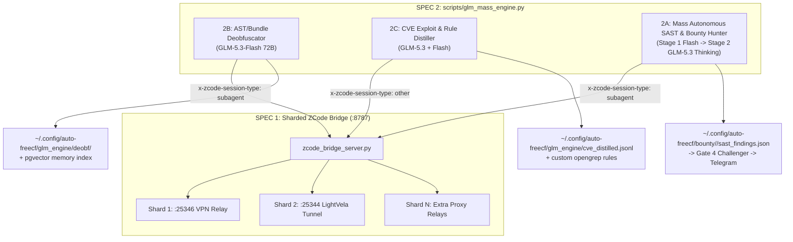

# Technical Specification: GLM-5.3 120B Token High-Throughput Engine (Spec 1 & Spec 2)

## 0. Measured Supply & Expiry Constraints
- **Source**: `~/.zcode-bridge/balance.json` (245 accounts, 237 with active `zcode-v3-start-plan-1024`).
- **Available Quota**:
  - `GLM-5.3-Flash`: **72,085,000,000 tokens** (`cap: model:glm-5.3-flash`, 300M/account).
  - `GLM-5.3` (Flagship Thinking): **47,991,000,000 tokens** (`cap: model:glm-5.3`, 200M/account).
  - **Combined Total**: **120,076,000,000 tokens** (~120.08B).
- **Expiration Window**: `period_end` = `1792976400` (~15.5 to 24.5 hours remaining).
- **Core Bottleneck**: `scripts/zcode_bridge_server.py` enforces a single global `_UPSTREAM_SLOT = threading.Semaphore(1)` with `UPSTREAM_MIN_GAP = 3.0` seconds and `UPSTREAM_MAX_WAITING = 2`, funneling all 237 accounts through a single egress proxy (`127.0.0.1:25346`). At 20 req/min, maximum theoretical burn is <1.5B tokens/day (98.8% wasted).

---

## 1. SPEC 1: `zcode.cjs` Reverse Engineering & Per-Egress Sharded Transport

### 1.1 Reverse Engineering Findings (`resources/glm/zcode.cjs`, 14.8 MB)
1. **Client Request Signing (`cRs` at offset `3711941`)**:
   ```javascript
   function cRs({access: e, baseURL: t}) {
     if (e.type === "zhipu-account" && (e.mode === "start-plan" || e.mode === "off-peak")) return false;
     ...
   }
   ```
   - **Fact**: `start-plan` and `off-peak` accounts **explicitly bypass** Ed25519/HMAC `x-client-sig` and `x-client-pow` headers (`reason: "access_mode"`). No cryptographic request signing is required on `zcode.z.ai/api/v1/zcode-plan/*`.
2. **Session Type Attribution (`xst` & `eln` at offset `3939158`, `WR` enum)**:
   - Valid `x-zcode-session-type` values in `WR`:
     - `"main"` (`WR.Main` — primary interactive chat)
     - `"subagent"` (`WR.Subagent` — parallel subagent execution, strips `subagent_agent_` prefix from `x-session-id`)
     - `"other"` (`WR.Other` — background tasks: compaction, title generation, workspace indexing)
   - Concurrency error `3009` (`kIo = new Set(["3008", "3009", "3010"])`) is tracked per `(account, x-zcode-session-type, x-session-id)`. Supporting caller-supplied or round-robin `x-zcode-session-type` (`main` / `subagent` / `other`) avoids main-session slot contention.
3. **Anthropic Prompt Caching (`b1s` & `G1s` at offset `3725810+`)**:
   - The upstream `zcode-plan/anthropic/v1/messages` endpoint supports `cache_control: {"type": "ephemeral"}` on system blocks and user message blocks (up to 4 breakpoints), plus `"anthropic-beta": "mid-conversation-system-2026-04-07,prompt-caching-2024-07-31"`.
   - Attaching `cache_control: {"type": "ephemeral"}` to large static context blocks (e.g., repository context, AST chunks, CVE schemas) accelerates multi-turn/multi-pass analysis while counting full context window tokens.
4. **Upstream Error Taxonomy (`GDe` map at offset `3921711`)**:
   - `1005`, `1308`, `1310`, `1313`: Quota exhausted (`retryable: false` on same account $\to$ immediate account failover).
   - `3008`, `3009`, `3010`: Rate/concurrency limit (`xIo = [1000, 2000]` ms backoff or rotate account/session).
   - `3012`: Account/IP anti-abuse block (WAF/velocity). Triggered when $>2$ concurrent requests or rapid multi-account rotation hits `zcode.z.ai` from a **single egress IP**.

### 1.2 Architecture: Per-Egress Sharding in `scripts/zcode_bridge_server.py`
Instead of one global lock across the entire bridge:
1. **Egress Pool Configuration (`config.json` $\to$ `egress.shards`)**:
   - Supports a list of egress endpoints: e.g. `["http://127.0.0.1:25346", "http://127.0.0.1:25344", "direct"]` or dynamic local relay ports from `egress.py` / `proxy_pool.py`.
   - Deterministic Account-to-Shard Pinning:
     $$\text{shard\_idx}(\text{email}) = \text{crc32}(\text{email}) \bmod N_{\text{healthy\_shards}}$$
   - Why deterministic pinning: Prevents account $A$ from jumping across multiple IPs within seconds, and prevents 10 accounts from bursting on IP 1 simultaneously.
2. **Per-Shard Rate Limiter (`_ShardGate`)**:
   - Each egress shard $S_i$ maintains its own:
     - `semaphore = threading.Semaphore(1)` (1 setup at a time per egress IP)
     - `min_gap = 1.5s` (for `subagent`/`other` sessions) or `2.5s` (for `main`)
     - `max_waiting = 8` (raised from 2 so batch workers block and queue cleanly instead of dropping with 429 `UpstreamBusy`)
   - With $K$ shards active, bridge throughput scales linearly ($K \times$) while keeping per-IP traffic strictly below Alibaba WAF / `3012` thresholds.
3. **Header & Caching Enhancements**:
   - Allow client request headers or payload metadata to specify `x-zcode-session-type` (`main` | `subagent` | `other`). Default to `subagent` when called from batch jobs (`X-ZCode-Batch: 1`).
   - Preserve `cache_control` on user content blocks in `_oa_to_anthropic()` and automatically attach `cache_control: {"type": "ephemeral"}` to large system/context blocks when requested.

---

## 2. SPEC 2: High-Value Token Consumption Pipelines (`scripts/glm_mass_engine.py`)

All three workloads live in a single unified script (`scripts/glm_mass_engine.py`) with subcommands (`deobfuscate`, `distill-cve`, `hunt-sast`, `status`) and durable output under `~/.config/auto-freecf/glm_engine/`.



### 2.1 Project 2B: Binary / Bundle AST Deobfuscator & Security Mapper (`deobfuscate`)
- **Objective**: Turn opaque, minified JS bundles (`zcode.cjs`, `/tmp/ocjs/*.js`, `grok-bot`, and bounty target web bundles) into human-readable architecture maps, recovered symbol tables, and security sink inventories.
- **Model**: `GLM-5.3-Flash` (draws from the 72.08B bucket).
- **Pipeline**:
  1. **Chunker**: Splits large JS bundles along top-level function/module boundaries (`function `, `var X = Y(()=>`, webpack/esbuild module wrappers) into 30 KB–60 KB chunks (~10K–18K tokens).
  2. **Analyzer Prompt**: Extracts:
     - `module_purpose`: 1-sentence summary.
     - `symbol_map`: `{minified_name: semantic_name}`.
     - `endpoints_and_rpc`: URLs, headers, IPC channels, auth tokens.
     - `security_sinks`: DOM XSS, `eval`, prototype pollution, postMessage handlers, SSRF, hardcoded secrets, auth bypasses.
  3. **Storage**: Writes structured JSONL to `~/.config/auto-freecf/glm_engine/deobf/<bundle>.jsonl` and markdown summaries to `reports/deobf-<bundle>.md`.

### 2.2 Project 2C: High-Severity CVE Deep-Reasoning & Rule Distiller (`distill-cve`)
- **Objective**: Convert raw CVE descriptions in `~/.config/auto-freecf/cve.db` (390K CVEs) into actionable vulnerability detection signatures (Opengrep/Semgrep YAML rules + taint source-to-sink patterns + exploit PoC templates) before the 120B tokens expire.
- **Model**: `GLM-5.3` (48B Thinking bucket) + `GLM-5.3-Flash`.
- **Pipeline**:
  1. **Query**: Selects high-value CVEs (`cvss >= 7.5`, CWE-89 SQLi, CWE-79 XSS, CWE-918 SSRF, CWE-639 IDOR, CWE-287 Auth Bypass, CWE-502 Deserialization, CWE-22 Path Traversal) from `cve.db`.
  2. **Distillation**: In batches of 15 CVEs per prompt, `GLM-5.3` synthesizes:
     - `root_cause_pattern`: Exact code anti-pattern.
     - `opengrep_rule`: Ready-to-run YAML rule snippet.
     - `verification_poc`: Non-destructive HTTP/CLI verification probe.
  3. **Storage**: Appends to `~/.config/auto-freecf/glm_engine/cve_distilled.jsonl` for permanent local RAG and SAST rule generation.

### 2.3 Project 2A: Mass Autonomous SAST & Bounty Zero-Day Hunter (`hunt-sast`)
- **Execution Order**: **Runs LAST after Spec 1, Spec 2B, and Spec 2C are implemented and verified.**
- **Objective**: Hunt real vulnerabilities across in-scope Bugcrowd/HackerOne targets (`~/.config/auto-freecf/bounty/*` + live JS/source assets from `live.txt`).
- **Two-Stage Funnel**:
  - **Stage 0 (Scope Gate)**: Enforces `bounty_run.host_in_scope(host, in_scope, out_of_scope)` on every URL/host before fetching any JS bundle or source file. Out-of-scope hosts are never touched.
  - **Stage 1 (Broad Sink & Logic Scanner — `GLM-5.3-Flash`, 72B pool)**:
    - Harvests in-scope web responses, inline scripts, external `.js` bundles, API schemas, and source files.
    - Scans 40 KB–80 KB chunks for client/server vulnerabilities:
      - Hardcoded API keys / internal staging endpoints / GraphQL mutations
      - IDOR / BOLA parameter patterns (`/api/v1/users/{id}`, unverified `org_id`/`account_id`)
      - DOM XSS (`innerHTML`, `dangerouslySetInnerHTML`, `location.search` / `postMessage` without origin check)
      - Open Redirect / SSRF / OAuth `redirect_uri` manipulation
  - **Stage 2 (Cross-File Taint & Exploit Verifier — `GLM-5.3` Thinking, 48B pool)**:
    - Takes every candidate flagged by Stage 1.
    - Performs deep reasoning to eliminate false positives: traces source $\to$ sanitizer $\to$ sink, checks if the endpoint/parameter is actually reachable by an unauthenticated or low-privilege attacker, and drafts a concrete reproduction proof.
  - **Stage 3 (Bounty Gate Integration)**:
    - Saves verified candidates into `~/.config/auto-freecf/bounty/<job_id>/glm_sast_findings.json` and `reports/glm-sast-summary.md` ready for `bounty_run.py triage`.

---

## 3. Verification & Safety Invariants
1. **No 9Router Restart**: All changes are inside `scripts/zcode_bridge_server.py` (restarted cleanly via `systemctl --user restart zcode-bridge`) and `scripts/glm_mass_engine.py`.
2. **Scope Gate 1 Enforcement**: `hunt-sast` imports `host_in_scope` directly from `scripts/bounty_run.py` and refuses any target not passing the allow/deny check.
3. **WAF / 3012 Guard**: If any shard sees `code == 3012` or HTTP `405`, that shard enters a 120-second cooldown and stops rotating accounts on that IP.
4. **Durable State**: All outputs written to `~/.config/auto-freecf/glm_engine/`, never `/tmp`.
